#### Міністерство освіти і науки України
#### Національний технічний університет України
#### «Київський політехнічний інститут імені Ігоря Сікорського»
#### Факультет інформатики та обчислювальної техніки
#### Кафедра обчислювальної техніки
---
# Лабороторна робота №1
## з дисципліни «Структури даних і алгоритми»


#### Виконав
Студент групи: ІО-61\
Мельник Дмитро Віталійович\
номер у списку групи: 15

#### Перевірив
Русінов Володимир Володимирович


#### Київ 2026

---
## Завдання 

Задаєтся дійсне число х, визначити значення х ща варіантом кусково неперервної функції y(x), якщо вона існує.\
```
         f1(x) ,  x ∈ D1
y(x) =
         f2(x) ,  x ∈ D2
```
Розв'язати задачу двома способами:
### Умови першого способу:
##### Варіант 15
f1(x), x ∈ D1\
x³ – 6, x ∈ (–10,–5] ∪ (5,15]\
f2(x), x ∈ D2\
2x³ – 3x + 2, x ∈ [25, +∞)

1. У програмі дозволяється використовувати тільки одиничні операції порівняння (`=`, `<>`, `<`, `<=`, `>`, `>=`) і **не дозволяється** використовувати булеві (логічні) операції (`not`, `and`, `or` тощо);
---
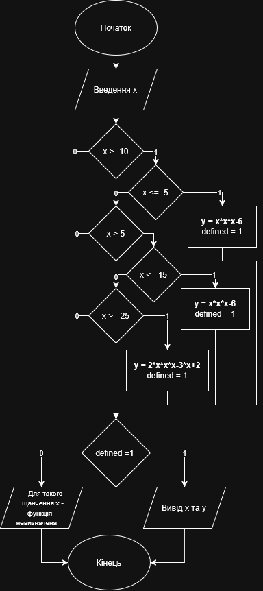
---
```c
#include <stdio.h>
int main() {
    float x = 0.0;
    float y = 0.0;
    int defined = 0;

    printf("Write real number x: ");
    scanf_s("%f", &x);
    if (x > -10) {
        if (x <= -5) {
            y=x*x*x-6;
            defined=1;
        } else if (x > 5) {
            if (x <= 15) {
                y=x*x*x-6;
                defined=1;
            } else if (x >= 25) {
                y=2*x*x*x-3*x+2;
                defined=1;
            }
        }
    }
    if (defined==1) {
        printf("y(%.4f) = %.4f\n", x, y);
    } else {
        printf("For such x = %.4f function is undefined", x);
    }
    return 0;
}
```
#### Скріншоти тестів:
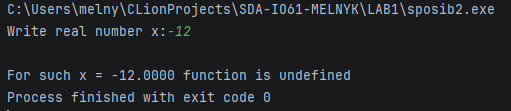
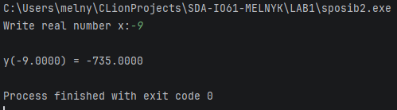
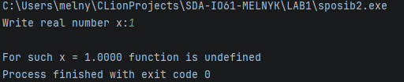
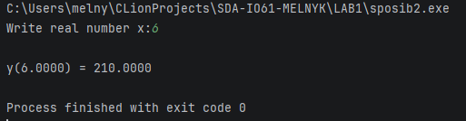
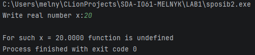
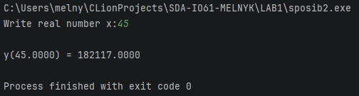

### Умови другого способу:
##### Варіант 15
f1(x), x ∈ D1\
x³ – 6, x ∈ (–10,–5] ∪ (5,15]\
f2(x), x ∈ D2\
2x³ – 3x + 2, x ∈ [25, +∞)

2. У програмі необхідно **обов'язково** використати булеві (логічні) операції (`not`, `and`, `or` тощо); використання булевих операцій не повинно бути надлишковим.
---
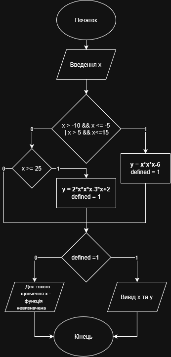
---
```c
#include <stdio.h>
int main() {
    float x = 0.0;
    float y = 0.0;
    int defined = 0;

    printf("Write real number x: ");
    scanf_s("%f", &x);

    if ((x > -10 && x <= -5) || (x > 5 && x <= 15)) {
        y=x*x*x-6;
        defined=1;
    } else if (x >= 25) {
        y=2*x*x*x-3*x+2;
        defined=1;
    }

    if (defined==1) {
        printf("y(%.4f) = %.4f\n", x, y);
    } else {
        printf("For such x = %.4f function is undefined", x);
    }
    return 0;
}
```
#### Скріншоти тестів:
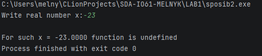
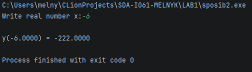
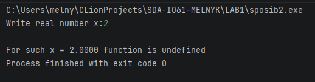
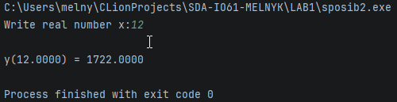
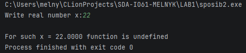
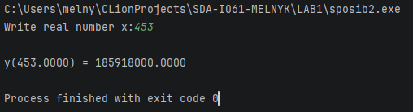
