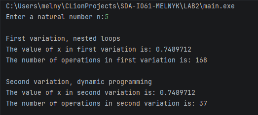
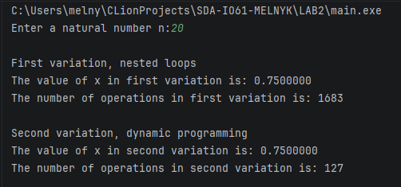
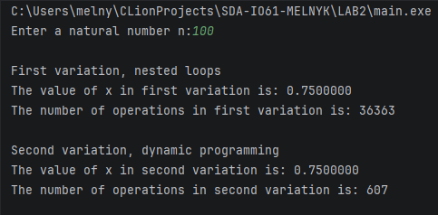
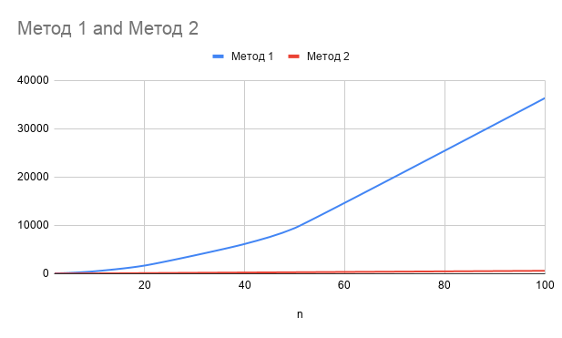
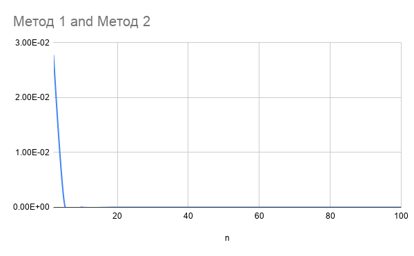
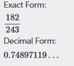
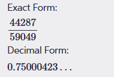
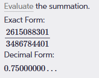

#### Міністерство освіти і науки України
#### Національний технічний університет України
#### «Київський політехнічний інститут імені Ігоря Сікорського»
#### Факультет інформатики та обчислювальної техніки
####  Кафедра обчислювальної техніки
---
# Лабороторна робота №2
## з дисципліни «Структури даних і алгоритми»


#### Виконав
Студент групи: ІО-61\
Мельник Дмитро Віталійович\
номер у списку групи: 15

#### Перевірив
Русінов Володимир Володимирович


#### Київ 2026

---

## Постановка задачі

1. Задане натуральне число n. Обчислити значення заданої за варіантом формули (ряду або добутку, що наближено обчислює значення певної функції у заданій точці; точність наближення залежить від кількості ітерацій n).
2. Для розв'язання задачі написати **дві програми**:
    1. перша програма обчислює формулу за допомогою **вкладених циклів**;
    2. друга програма обчислює ту саму формулу за допомогою **одного циклу** з використанням **методу динамічного програмування** (тобто накопичуючи черговий доданок/множник на основі попереднього, без повторного обчислення статечних, факторіальних і подібних виразів «з нуля» на кожній ітерації).
3. Виконати розрахунок кількості операцій для кожного з алгоритмів за методикою, викладеною на лекції, додавши до неї підрахунок кількості викликів стандартних функцій.
4. Програма має правильно розв'язувати задачу при будь-якому заданому n, для якого результат обчислення коректно представляється типом `double`.
5. Результат виводити у форматі із **сімома знаками після коми**.
## Задача за варіантом
15: S = 1/(1+x) = Σ(i=0..n) (−1)^i · x^i  (x = 1/3)
## Код
Включає та виводить результати обох програм в 1 файлі
```c
//S = 1/(1+x) = Σ(i=0..n) (−1)^i · x^i (x = 1/3)
#include <stdio.h>

int main() {
    int n;
    double x = 1.0 / 3.0;

    printf("Enter a natural number n: ");
    if (scanf_s("%d", &n) != true || n < 0) {
        printf("n must be a natural number.\n");
    }
    double suma = 0;
    long long cntr = 0;
    cntr+=2; // suma= and cntr =
    for (int i = 0; i <= n; i++) {
        cntr++; // i=
        double powerx = 1.0;
        double sign = 1.0;
        cntr+=2; // powerx= and sign=
        for (int j = 0; j < i; j++) {
            cntr+=2; //j= and j<i
            powerx *= x;
            cntr++; // powerx* and =
            cntr++; //j++
        }
        cntr++; //last j<i
        cntr++; //k=
        for (int k = 0; k < i; k++) {
            cntr++; //k<i
            sign *= -1.0;
            cntr++; // sign* and =
            cntr++; // k++
        }
        cntr++; // last k<i
        suma += sign * powerx;
        cntr+=3; //suma +, =, *
        cntr++; // i++
    }
    cntr++; // last i<=n

    double suma2 = 0.0;
    double term = 1.0;
    double negx = -x;
    long long cntr2 = 0;

    for (int i = 0; i <= n; i++) {
        cntr2++; // i=
        suma2 += term;
        cntr2+=2; // suma2 + and =
        term *= negx;
        cntr2+=2; //cntr + and =
        cntr2++; // i++
    }
    cntr2++; // last i<=n

    printf("First variation, nested loops\n");
    printf("The value of x in first variation is: %.7lf\n", suma);
    printf("The number of operations in first variation is: %lld\n\n", cntr);
    printf("Second variation, dynamic programming\n");
    printf("The value of x in second variation is: %.7lf\n", suma2);
    printf("The number of operations in second variation is: %lld\n", cntr2);
}

```
## Скріншоти тестування програм
n = 5\
\
n = 20\
\
n = 100\
\
## Таблиця з результатами запуску програм
| n                                                      | 2   | 5   | 10  | 20   | 40   | 50   | 100   |
| ------------------------------------------------------ | --- | --- | --- | ---- | ---- | ---- | ----- |
| Кількість операцій, спосіб 1 (вкладені цикли)          | 54  | 168 | 498 | 1683 | 6153 | 9438 | 36363 |
| Кількість операцій, спосіб 2 (динамічне програмування) | 19  | 37  | 67  | 127  | 247  | 307  | 607   |

### Графік залежності кількості операцій від n для кожного зі способів
\
## Абсолютна похибка
Обидва способи обчислюють одну й ту саму математичну суму, їхні результати та похибки ідентичні.

| n | Абсолютна похибка |
| :--- | :--- |
| 2 | 2.778e-02 |
| 5 | 1.029e-03 |
| 10 | 4.233e-06 |
| 20 | 7.170e-11 |
| 40 | 2.056e-20 |
| 50 | 3.482e-25 |
| 100 | 4.850e-49 |

### Графік похибки обчислень у залежності від n

## Результати перевірки правильності обчислень на калькуляторі
n = 5\
\
n = 10\
\
n = 20\
\

## Висновки
Порівнюючи 2 способи із вкладеними циклами та з використанням методу динамічного програмування для вирішення задачі ми можемо побачити, що перший спосіб має набагато більше операцій.
Тим часом другий спосіб також має простіший та коротший код.
Через те що 2 програми роблять одні і ті самі дії результати при однакових значеннях n є ідентичними.
З цього ж випливає що і похибки теж однакові. Після значення n = 15 похибка стає незначною, але чим менше n - тим більше стає похибка.
Підсумовуючи, варіант з динамічним програмуванням виявився ефективнішим через меншу кільк. операцій та меншого коду при цьому видаючи однаковий результат з першим варіантом.